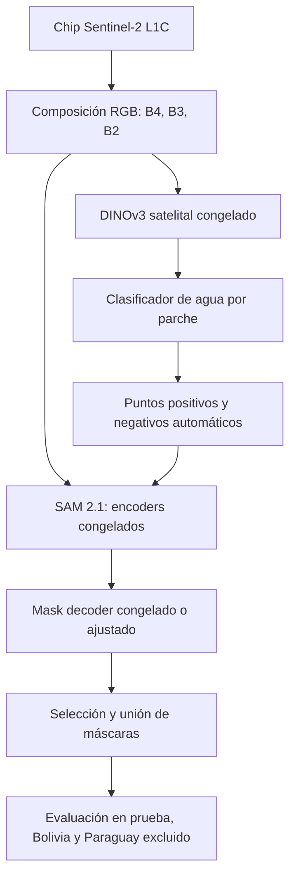

# auto-prompt-sam2

**El costo del prompt: segmentación automática de agua superficial en Sentinel-2 con prompts derivados de DINOv3 para SAM 2.1.**

Proyecto de investigación del curso **Deep Learning (1INF52), semestre 2026-2**, de Ingeniería Informática de la **Pontificia Universidad Católica del Perú (PUCP)**, con presentación prevista en **WAIMLAP 2026** (*Workshop on Artificial Intelligence and Machine Learning Applications*).

El proyecto estudia cuánto cambia la calidad de segmentación de SAM 2.1 cuando se reemplazan los puntos proporcionados por una persona por puntos generados automáticamente a partir de características de DINOv3. El caso de estudio son imágenes satelitales Sentinel-2 de eventos de inundación del dataset Sen1Floods11.

La ejecución se organizará en **dos fases principales**: experimentación y entrenamiento en **Google Colab**, seguidos de la construcción de una demo con **Gradio** y su despliegue en **Hugging Face Spaces**. Estas herramientas son decisiones del proyecto para el trabajo pendiente.

> **Estado actual (2026-10-28):** etapas 1 y 2 concluidas (2/9), con consulta de licencia de Sen1Floods11 pendiente. Etapa 2: 446 pares manuales con hashes, ambos splits y preprocesamiento por régimen, validados localmente y con preparación/recuperación offline en Colab revisadas a partir del notebook y el informe del usuario. No hay pesos, modelos ejecutados, entrenamientos, evaluaciones finales ni demo. Véase el [estado de fase 1](docs/project/estado_actual_fase1.md).

## Pregunta de investigación y alcance

¿Cuánta calidad de segmentación, medida mediante la IoU de agua, se pierde al reemplazar los prompts humanos simulados de SAM 2.1 por prompts automáticos derivados de DINOv3? ¿Cómo cambia esa diferencia en un evento geográfico que no se utilizó para entrenamiento ni calibración?

En este proyecto, un **prompt** es una indicación espacial que guía la máscara de SAM, por ejemplo, puntos positivos dentro del agua y negativos fuera de ella. El **costo del prompt** se refiere a la diferencia de calidad frente a una referencia asistida por etiquetas; la latencia y la memoria se medirán por separado.

Las etiquetas de Sen1Floods11 incluyen agua permanente, como ríos y lagos. Por ello, el alcance es la **segmentación de agua superficial** en escenas de inundación, sin distinguir automáticamente agua permanente de agua causada por una inundación. La contribución prevista es una evaluación controlada de la automatización de prompts y su generalización geográfica.

## Objetivos

**Objetivo general:** cuantificar el costo de sustituir prompts humanos simulados por prompts automáticos en SAM 2.1 para segmentar agua en Sentinel-2, y analizar su comportamiento ante cambios de dominio y de evento geográfico.

Objetivos específicos:

1. Reproducir una línea base con SAM 2.1 congelado y puntos obtenidos de las etiquetas de referencia.
2. Analizar la arquitectura de SAM 2.1 y DINOv3 mediante parámetros, FLOPs, características intermedias, campo receptivo, latencia y memoria.
3. Generar puntos positivos y negativos automáticamente a partir de características de DINOv3 y un clasificador de agua.
4. Intervenir el núcleo de SAM 2.1 ajustando únicamente su *mask decoder*, con ablaciones sobre la fuente y cantidad de prompts y el ajuste del decoder.
5. Evaluar la generalización en Bolivia y en una prueba que excluya Paraguay del entrenamiento y la calibración, y documentar los fallos.
6. Entregar una demo reproducible con Gradio en Hugging Face Spaces, un cuaderno de decisiones y los materiales académicos del proyecto.

## Fases de ejecución

### Fase 1. Experimentación y entrenamiento en Google Colab

**Objetivo:** desarrollar y evaluar el método de segmentación automática en notebooks ejecutados en Google Colab, y producir los componentes y resultados reproducibles que sustentarán la demo y el informe.

**Actividades:**

1. Preparar el entorno de Colab, documentar dependencias, hardware y semillas, gestionar el acceso a datos y modelos y preparar las particiones y el preprocesamiento de Sentinel-2.
2. Reproducir la línea base de SAM 2.1 con prompts simulados desde etiquetas y realizar la disección de SAM 2.1 y DINOv3, incluyendo parámetros, FLOPs, características intermedias, campo receptivo, latencia y memoria.
3. Extraer características con DINOv3 congelado, entrenar el clasificador de agua y generar puntos positivos y negativos automáticamente.
4. Ajustar únicamente el mask decoder de SAM 2.1, manteniendo congelados sus encoders de imagen y de prompts, y ejecutar las ablaciones sobre fuente y cantidad de prompts y ajuste del decoder.
5. Seleccionar configuraciones con validación, realizar la evaluación final y las pruebas geográficas reservadas, y analizar resultados y fallos según el protocolo documentado.
6. Guardar fuera del almacenamiento temporal de la sesión las configuraciones, versiones de modelos, particiones, parámetros de preprocesamiento, métricas, predicciones y checkpoints. Documentar cómo reanudar el trabajo y reconstruir la inferencia sin depender del estado de una sesión de Colab.

**Entregables:** notebooks reproducibles; entorno y configuraciones documentados; cuaderno de decisiones e hipótesis; resultados de la disección, las ablaciones y la evaluación; análisis de fallos; clasificador de agua entrenado y checkpoint del decoder ajustado. Los artefactos deberán identificar los modelos base utilizados y conservar los umbrales y parámetros necesarios para reproducir el flujo seleccionado.

#### Cobertura de los requisitos académicos A, B y C

Las fases A, B y C exigidas por el curso se cubrirán **dentro de la fase 1 de ejecución**. Son requisitos metodológicos y no añaden fases principales a la organización del proyecto.

| Requisito académico | Trabajo previsto en Google Colab |
| --- | --- |
| **A. Disección instrumentada** | Reproducir la línea base asistida y analizar parámetros y FLOPs por bloque, características intermedias, campo receptivo, latencia y memoria. |
| **B. Intervención en el núcleo** | Automatizar los prompts y ajustar solo el mask decoder, contrastando cada cambio con una hipótesis previa y su ablación controlada. |
| **C. Estrés y análisis de fallos** | Evaluar la transferencia geográfica y estudiar errores en agua turbia, vegetación inundada, sombras de nubes y relieve. Registrar también lo que no funcione. |

### Fase 2. Construcción y despliegue de la demo funcional

**Objetivo:** convertir el flujo de inferencia seleccionado en la fase 1 en una aplicación con Gradio desplegada en Hugging Face Spaces, que permita probar la segmentación automática de agua sin proporcionar prompts humanos.

**Actividades:**

1. Integrar el preprocesamiento, la extracción de características, el clasificador de agua, la generación de puntos y la segmentación en un flujo reutilizable de inferencia.
2. Cargar las versiones de SAM 2.1 y DINOv3 documentadas, los pesos del clasificador y el checkpoint del decoder correspondiente a la configuración seleccionada, junto con sus umbrales y parámetros. El despliegue realizará inferencia con esos artefactos; el entrenamiento permanecerá en Colab.
3. Construir la interfaz con Gradio para cargar un chip Sentinel-2 compatible con el preprocesamiento definido y visualizar la imagen, la máscara de agua y los puntos automáticos. Incorporar comparaciones entre estrategias cuando sus componentes estén disponibles.
4. Validar la carga de entradas y modelos, la coherencia de las predicciones con la inferencia de Colab y el consumo de recursos; preparar dependencias y acceso a pesos y desplegar la aplicación en Hugging Face Spaces con instrucciones de uso y limitaciones.

**Entregables:** aplicación de Gradio y código de inferencia; dependencias y configuración de despliegue; acceso documentado a los pesos necesarios; demo funcional en Hugging Face Spaces; ejemplos de entrada e instrucciones de uso; comprobaciones de funcionamiento y correspondencia con el flujo evaluado.

**Conexión entre ambas fases:** la fase 1 entregará una configuración seleccionada con validación, sus componentes entrenados y el preprocesamiento y posprocesamiento documentados. La fase 2 reutilizará esos artefactos para servir predicciones sin etiquetas de referencia. Los resultados experimentales y el análisis de fallos de la fase 1 sustentarán el informe y el póster, mientras que la fase 2 aportará la demostración funcional del método.

## Metodología propuesta

El [resumen para WAIMLAP](docs/WAIMLAP/Abstract_CostOfThePrompt.md) detalla el protocolo que se resume aquí. La [propuesta inicial](docs/project/draft/propuesta_inicial_deep_learning.md) y sus diapositivas conservan el planteamiento original.



### Modelos y generación de prompts

| Componente | Función prevista |
| --- | --- |
| **SAM 2.1** | Modelo de segmentación principal, con la variante **tiny** como primera opción por las restricciones de cómputo. |
| **DINOv3 ViT-L/16 satelital** | Extractor congelado de características por parche, con el checkpoint propuesto `facebook/dinov3-vitl16-pretrain-sat493m`. |
| **Clasificador de agua (*probe*)** | Regresión logística sobre las características de DINOv3 para estimar probabilidades de agua, entrenada únicamente con etiquetas del conjunto de entrenamiento. |
| **Mask decoder de SAM 2.1** | Único bloque de SAM que se ajustará, usando entropía cruzada binaria (BCE) y pérdida Dice. Los encoders de imagen y de prompts permanecerán congelados. |

Los máximos del mapa de probabilidad producirán puntos positivos y las zonas de baja probabilidad producirán puntos negativos. SAM se ejecutará por componente conectado; se seleccionará la máscara con mayor IoU predicha y se unirán las máscaras para obtener una predicción binaria. También se contempla una variante del generador que use pseudoetiquetas de NDWI en lugar de etiquetas manuales.

La línea base utilizará puntos simulados desde las máscaras reales. Como requiere etiquetas para construir los prompts, servirá como **referencia asistida**, sin representar un sistema desplegable. La alternativa de malla automática generará máscaras sin clase, que se identificarán como agua mediante su probabilidad media estimada por DINOv3 y el clasificador.

La propuesta inicial contemplaba una comparación adicional con SAM 3 mediante texto. El protocolo descrito en el resumen y el póster se concentra en SAM 2.1 y prompts espaciales; SAM 2.1 no recibe prompts de texto.

## Datos y protocolo de evaluación

Se propone utilizar los **446 chips con anotaciones manuales de Sen1Floods11**, en su modalidad Sentinel-2 L1C: imágenes de **512 × 512 píxeles**, **10 m de resolución** y **13 bandas**. Las etiquetas son `1` para agua, `0` para no agua y `-1` para píxeles inválidos.

| Partición | Chips | Uso previsto |
| --- | ---: | --- |
| Entrenamiento | 252 | Entrenar el clasificador de agua y ajustar el decoder. |
| Validación | 89 | Seleccionar umbrales e hiperparámetros. |
| Prueba | 90 | Evaluación final en eventos presentes en las particiones oficiales. |
| Bolivia | 15 | Evaluación de transferencia a un evento reservado. |

El protocolo incluye además una ejecución **leave-Paraguay-out**: los 67 chips de Paraguay se excluirán del entrenamiento, la calibración y la selección de modelos para evaluar la generalización a ese evento. Esta ejecución es independiente del uso habitual de las particiones oficiales, donde Paraguay aparece en entrenamiento, validación y prueba.

El preprocesamiento propuesto usa RGB **B4, B3 y B2**, reflectancia dividida entre 10 000, recorte con un límite fijado a partir del entrenamiento y normalización propia de cada modelo. Los píxeles inválidos se excluirán de las pérdidas y métricas.

Los umbrales se seleccionarán con validación. Prueba y Bolivia se evaluarán una vez al final. Como las particiones por chip pueden contener zonas vecinas de un mismo evento, la evidencia de transferencia geográfica se apoyará en Bolivia y en la ejecución que excluye Paraguay.

### Ablaciones y métricas

| Ablación | Comparación | Hipótesis previa |
| --- | --- | --- |
| **A1. Fuente del prompt** | Puntos simulados desde etiquetas, puntos de DINOv3, caja del chip completo y malla automática con clasificación de máscaras. | Los puntos de DINOv3 quedarán por debajo de la referencia asistida y por encima de la malla. |
| **A2. Cantidad de puntos** | Variar la cantidad de puntos por componente y analizar puntos positivos y negativos. | La IoU aumentará hasta saturarse; los negativos ayudarán a reducir falsos positivos. |
| **A3. Ajuste del decoder** | Mask decoder congelado frente a ajustado con prompts automáticos. | El ajuste beneficiará más a los eventos vistos que a Bolivia. |

La métrica principal será la **IoU de la clase agua**, agregada sobre píxeles válidos y reportada también por evento y por chip. Se complementará con precisión, recall, Dice/F1 y mIoU de las dos clases. Los chips sin agua se excluirán de la IoU individual, pero se conservarán en las métricas agregadas y se reportará su área de falsos positivos.

El análisis de eficiencia incluirá parámetros, FLOPs, mediana de latencia tras calentamiento y memoria GPU máxima, documentando hardware, precisión y condiciones de medición. Las hipótesis de las ablaciones son expectativas por contrastar, no resultados obtenidos.

## Organización del repositorio

```text
auto-prompt-sam2/
├── README.md
└── docs/
    ├── course/
    │   └── tarea_final_deep_learning.md
    ├── project/
    │   └── draft/
    │       ├── propuesta_inicial_deep_learning.md
    │       └── El Costo del Prompt - INF52 PUCP_slides.pdf
    └── WAIMLAP/
        ├── Abstract_CostOfThePrompt.md
        └── Poster_CostOfThePrompt.pptx
```

| Carpeta o documento | Contenido |
| --- | --- |
| [`docs/`](docs/) | Documentación académica y de investigación del proyecto. |
| [`docs/course/`](docs/course/) | Documentos del curso Deep Learning. |
| [Bases de la tarea final](docs/course/tarea_final_deep_learning.md) | Objetivos, fases obligatorias, criterios de evaluación, entregables y política de uso de IA. |
| [`docs/project/`](docs/project/) | Documentación propia del proyecto. |
| [`docs/project/draft/`](docs/project/draft/) | Propuesta inicial y materiales de su presentación. |
| [Propuesta inicial](docs/project/draft/propuesta_inicial_deep_learning.md) | Pregunta de investigación, modelos, datos, hipótesis, riesgos y plan inicial. |
| [Diapositivas de la propuesta](docs/project/draft/El%20Costo%20del%20Prompt%20-%20INF52%20PUCP_slides.pdf) | Presentación del entregable E1. |
| [`docs/WAIMLAP/`](docs/WAIMLAP/) | Materiales para el evento de presentación del proyecto. |
| [Resumen para WAIMLAP](docs/WAIMLAP/Abstract_CostOfThePrompt.md) | Diseño metodológico detallado, evaluación prevista, limitaciones y referencias bibliográficas. |
| [Póster para WAIMLAP](docs/WAIMLAP/Poster_CostOfThePrompt.pptx) | Presentación visual del diseño de investigación y de la evaluación prevista. |

## Entregables y reproducibilidad

El curso exige una línea base reproducida, una intervención de núcleo con ablación controlada, evaluación bajo cambio de dominio, análisis de fallos, una demo y un cuaderno de decisiones. Cada ablación deberá registrar la hipótesis antes de ejecutarse, el cambio realizado y el resultado observado. El cuaderno también deberá indicar dónde se utilizó asistencia de IA.

| Hito | Fecha consignada en los documentos |
| --- | --- |
| E1: propuesta de tema | 7 de octubre de 2026 |
| E2: disección del modelo, intervención preliminar y cuaderno de decisiones | 21 de octubre de 2026 |
| E3: entrega de trabajo e informe final de 4–8 páginas | 11 de noviembre de 2026 |
| E4: presentación del póster en WAIMLAP | 18–20 de noviembre de 2026 |

Estas fechas describen el cronograma académico y no acreditan que los entregables se hayan completado. Las bases del curso repiten la identificación E3 para el trabajo y el informe, y mencionan revisión con retroalimentación del workshop aunque consignan una fecha anterior al evento; ese punto requiere confirmación con el docente.

La entrega final reunirá los notebooks y resultados reproducibles de Google Colab, la demo con Gradio desplegada en Hugging Face Spaces, el cuaderno de decisiones, el informe de 4–8 páginas y el póster para WAIMLAP. Se contempla, opcionalmente, un chip de Perú para análisis cualitativo sin etiquetas.

**Etapa 1 concluida con salvedad de licencia, por decisión del usuario:** [notebook de Colab](notebooks/01_entorno_colab.ipynb), [configuración](configs/environment.yaml), [dependencias fijadas](requirements-colab.txt), [validación y pasos de ejecución](docs/project/validacion_etapa1.md), [accesos y licencias](docs/project/accesos_y_licencias.md) y [cuaderno de decisiones](docs/project/cuaderno_decisiones.md). **Etapa 2 concluida:** [notebook de datos](notebooks/02_datos_y_splits.ipynb), [informe y revisión Colab](docs/project/validacion_etapa2.md), [manifiestos y evidencia](docs/project/evidence/stage2/). Las etapas 3–9 y la fase 2 siguen sin implementar.

Para llevar los archivos actuales a Colab sin depender de cambios aún no publicados: ejecute `python scripts/export_colab_bundle.py`, suba el ZIP generado a Drive y abra el notebook. Configure el SHA-256 del ZIP y la raíz persistente; siga sus pasos `prepare` y `recover` en runtimes distintos. Esto no descarga datos ni pesos. Los bloqueos de licencia/acceso deben resolverse antes de pasar a etapas dependientes.

La estructura anterior describe la documentación original. Se añaden `configs/`, `notebooks/`, `src/auto_prompt_sam2/`, `scripts/`, `tests/` y evidencias en `docs/project/evidence/stage1/`.

Para repetir la etapa 2, use `python scripts/export_stage2_bundle.py` y el notebook 02, reutilizando el venv y la raíz persistente. El paquete nuevo no reemplaza el ZIP histórico de etapa 1. Los datos reales están en `artifacts/stage2-persistent/` local, ignorados por Git; el notebook permite adquirir/verificar los mismos objetos en Drive y ejecutar la recuperación `--offline`. [Validación de etapa 2](docs/project/validacion_etapa2.md) documenta comandos, estadísticas, límites y la evidencia Colab revisada.

## Limitaciones y decisiones por verificar

- Las etiquetas incluyen agua permanente y no permiten atribuir toda el agua segmentada a una inundación.
- La composición RGB descarta bandas NIR/SWIR que podrían aportar información para identificar agua.
- Existe una diferencia de resolución entre el preentrenamiento satelital de DINOv3 y Sentinel-2, además del cambio de imágenes naturales a satelitales para SAM.
- Nubes, sombras, agua turbia y vegetación inundada requieren un análisis específico de errores.
- Bolivia aporta solo 15 chips; el plan contempla una semilla y no promete significancia estadística ni mejoras de calidad.
- La ejecución en Colab deberá contemplar interrupciones de sesión y disponibilidad de recursos, con almacenamiento persistente y checkpoints que permitan reanudar el trabajo. El hardware de Hugging Face Spaces se definirá según las necesidades de memoria y latencia medidas para la demo.
- Se deben verificar las licencias de datos y modelos, los términos de acceso a los pesos y los recursos de cómputo antes de ejecutar los experimentos.

## Equipo y contexto académico

- **Integrantes:** Eliezer Guido Villarreal Quispe y Roberto Abel Chavez Javier.
- **Equipo:** Grupo 8, según las diapositivas de la propuesta.
- **Institución:** Pontificia Universidad Católica del Perú, Facultad de Ciencias e Ingeniería, Ingeniería Informática.
- **Curso:** Deep Learning (1INF52), semestre 2026-2.
- **Docente:** Dr. César A. Beltrán Castañón.
- **Evento previsto:** WAIMLAP 2026, Lima, Perú.

Las referencias bibliográficas completas y los antecedentes se encuentran en el [resumen para WAIMLAP](docs/WAIMLAP/Abstract_CostOfThePrompt.md).

