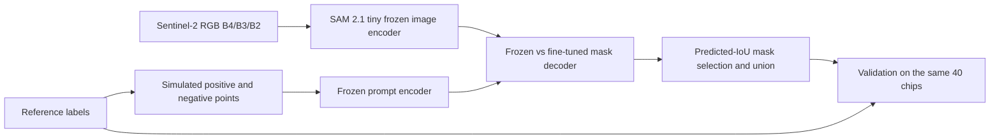

**Workshop on Artificial Intelligence and Machine Learning Applications**

# The Cost of the Prompt: Reference-Assisted SAM 2.1 Water Segmentation and Decoder Fine-Tuning in Sentinel-2 Imagery

**[VILLARREAL QUISPE, ELIEZER GUIDO]¹, [CHAVEZ JAVIER, ROBERTO ABEL]¹**

¹[Department / group – confirm], Pontificia Universidad Católica del Perú, Lima, Peru

Corresponding author: [corresponding author e-mail]

*Updated 3 November 2026 (America/Lima). Project phase 1 is complete under a reduced, two-notebook scope. This document reports the existing E2 experiment; it does not certify academic grading or completion of the later demo and final submissions.*

## 1. INTRODUCTION AND SCOPE

The project studies surface-water segmentation in Sentinel-2 chips from Sen1Floods11 (Bonafilia et al., 2020), using SAM 2.1 with spatial prompts. The original proposal asked how water IoU changes when label-simulated prompts are replaced by automatic DINOv3-derived prompts, including evaluation on unseen geographic events. That automatic pipeline and geographic evaluation were not implemented in the completed phase.

**Question addressed by the completed experiment.** With identical label-simulated points, validation chips and evaluation rules, does fine-tuning only the SAM 2.1 mask decoder improve pooled water IoU over the frozen decoder?

**Scope accepted at closure.** Phase 1 was simplified from an initial nine-stage plan into two notebooks: data/baseline/teardown and preliminary decoder intervention. It concludes an assisted experiment, not the original automatic prompting study. Labels include permanent water, so the task is surface-water segmentation rather than flood-only detection. The original title and automatic-prompt motivation remain project background; the current title reflects the measured experiment.

## 2. EXECUTED METHOD

**Part 1 — `E2_01_datos_baseline_teardown.ipynb`.** Prepares Sen1Floods11 data, splits and training-derived preprocessing, runs the frozen SAM 2.1 tiny reference-assisted baseline and instruments the model. The dataset preparation covers 446 manually labelled chips, with official train/validation/test counts of 252/89/90 and 15 Bolivia chips kept apart. The preliminary intervention uses only development subsets; reserved test and geographic evaluation were not run.

**Part 2 — `E2_02_intervencion_decoder.ipynb`.** Compares the frozen decoder (epoch 0) with a decoder fine-tuned using BCE+Dice on valid pixels. The image and prompt encoders remain frozen. Only the 4,215,109 mask-decoder parameters are configured as trainable, out of 38,962,498 total parameters. Frozen-block fingerprints and a gradient audit check the intervention boundary. The IoU-prediction and object-presence heads receive no gradient under this loss, as documented in the run.

The run uses the `official` regime, seed 42, 30 training chips (three per event) and 40 validation chips (four per event), selected by ID. Prompts use one positive and one negative point per water component, simulated from labels. Mask selection uses predicted IoU, and component masks are united. RGB preprocessing and prompt policy reuse the baseline contracts. Invalid label pixels are excluded from losses and metrics.

Training ran in Google Colab on a Tesla T4, float32, with Python 3.12.13, torch 2.7.1 and CUDA 12.6. AdamW used lr 5e-5, four-chip accumulation, at most five epochs and patience three. The hypothesis and refutation criterion were recorded before training: best-epoch validation water IoU must exceed the frozen arm on the same chips. The exact experimental code commit is `f399047464b89a3ed18972f8dc7f1b1364d83a44`.

DINOv3 was instrumented in an earlier teardown, but it was not used in this decoder experiment. No water probe or automatic prompt generator was trained.

## 3. OBSERVED RESULTS

Run `20261030T013250Z_2a795a89d5_f9fbd8b0`; values preserved from [report.json](../project/evidence/e2/colab_run_20261030T013250Z/run/report.json) and [history.csv](../project/evidence/e2/colab_run_20261030T013250Z/run/history.csv).

| Arm, same 40 validation chips | Pooled water IoU | Precision | Recall | Dice |
| --- | ---: | ---: | ---: | ---: |
| Frozen decoder, epoch 0 | 0.170378 | 0.171475 | 0.963819 | 0.291151 |
| Fine-tuned decoder, best epoch (1) | **0.308052** | 0.398793 | 0.575162 | 0.471009 |
| Fine-tuned decoder, last epoch (4) | 0.149928 | — | — | — |

Best-epoch IoU increases by 0.137673 (13.77 percentage points). Among 33 chips with defined individual IoU in both arms, 28 improve and five worsen. Seven water-free chips receive empty predictions by construction. Precision rises and recall falls: false-positive area decreases from approximately 401.1 to 72.6 million m², while real water is also lost. The result meets the experiment's pre-recorded criterion on this subset, without establishing generalization.

Validation IoU across fine-tuning epochs is 0.308052, 0.112774, 0.095690 and 0.149928. Training loss decreases throughout, but epochs 2–4 perform below the frozen arm. Training stops after epoch 4 under patience three. Overfitting and mismatch in predicted-IoU selection are possible explanations, not experimentally identified causes. Both the best and last results are retained.

The full-validation baseline antecedent reports water IoU 0.158044 on 89 `official` chips and 0.168434 on 75 `leave_paraguay_out` validation chips. These are different populations from the 40-chip intervention comparison and are not held-out geographic scores.

**Teardown.** SAM has 38,962,498 parameters and 296.05 counted GFLOPs, with explicitly partial operation coverage. The `E2_01` outputs report 152.6/154.9 ms latency for the official/excluded preprocessing regimes and peak allocated GPU memory of 684,419,584 B, with batch 1, float32, five warm-ups and 20 synchronized repetitions on T4. Features and gradient-based effective receptive fields describe local sensitivity on two training chips; they do not establish causal importance or water semantics. See [teardown_sam2.md](../project/teardown_sam2.md) for measurement scope.

## 4. CONCLUSIONS AND LIMITATIONS

The completed phase provides a reproducible assisted baseline, model teardown and controlled preliminary decoder intervention. The best epoch reduces false positives sufficiently to raise pooled IoU, but recall drops and later epochs deteriorate. This experiment does not yet measure the cost of replacing assisted prompts with automatic ones.

Conclusions are limited by one seed, small subsets, and selecting and reporting the best epoch on the same validation set. Label-derived prompts, including empty predictions for water-free chips, prevent treating this as a deployable automatic system. No final test, Bolivia or reserved-Paraguay evaluation, full A1–A3 matrix, or statistical significance claim is available. FLOPs and receptive-field measurements have documented methodological limits.

Recovery reproduced both evaluation arms with zero mask disagreement in a fresh Python process within the same Colab session; a full runtime restart was not evidenced for E2. Checkpoint identities and Drive locations are documented, with no weights committed to Git. The dataset licensing inquiry remains unresolved in the project record. Original outputs, including earlier template status text, are preserved as evidence.

**Project status.** Phase 1 is closed by the user's scope decision on 3 November 2026. The demo, final report, updated presentation poster and oral defense remain separate subsequent work. Automatic prompts and geographic stress testing require additional implementation and evaluation if that scope is resumed. Institutional and contact placeholders above still require completion before submission.

Evidence and interpretation: [phase-1 results](../project/resultados_fase1.md), [decision log](../project/cuaderno_decisiones.md), [E2 audit](../project/auditoria_E2.md). The [WAIMLAP material index](README.md) identifies the original poster as a historical design artifact pending revision for presentation. The bibliography below is retained from the original proposal for background; it is not an additional experimental result or a new literature review.

---

## REFERENCES

Bonafilia, D., Tellman, B., Anderson, T., & Issenberg, E. (2020). Sen1Floods11: A georeferenced dataset to train and test deep learning flood algorithms for Sentinel-1. In *2020 IEEE/CVF Conference on Computer Vision and Pattern Recognition Workshops (CVPRW)* (pp. 835–845). IEEE. https://doi.org/10.1109/CVPRW50498.2020.00113

Drusch, M., Del Bello, U., Carlier, S., Colin, O., Fernandez, V., Gascon, F., Hoersch, B., Isola, C., Laberinti, P., Martimort, P., Meygret, A., Spoto, F., Sy, O., Marchese, F., & Bargellini, P. (2012). Sentinel-2: ESA's optical high-resolution mission for GMES operational services. *Remote Sensing of Environment, 120*, 25–36. https://doi.org/10.1016/j.rse.2011.11.026

Kirillov, A., Mintun, E., Ravi, N., Mao, H., Rolland, C., Gustafson, L., Xiao, T., Whitehead, S., Berg, A. C., Lo, W.-Y., Dollár, P., & Girshick, R. (2023). Segment anything. In *2023 IEEE/CVF International Conference on Computer Vision (ICCV)* (pp. 3992–4003). IEEE. https://doi.org/10.1109/ICCV51070.2023.00371

Li, W., Hsu, C.-Y., Wang, S., Yang, Y., Lee, H., Liljedahl, A., Witharana, C., Yang, Y., Rogers, B. M., Arundel, S. T., Jones, M. B., McHenry, K., & Solis, P. (2024). Segment anything model can not segment anything: Assessing AI foundation model's generalizability in permafrost mapping. *Remote Sensing, 16*(5), Article 797. https://doi.org/10.3390/rs16050797

Liu, Y., Zhu, M., Li, H., Chen, H., Wang, X., & Shen, C. (2024). Matcher: Segment anything with one shot using all-purpose feature matching. In *International Conference on Learning Representations (ICLR 2024)*. https://proceedings.iclr.cc/paper_files/paper/2024/hash/4df9a5e6bad9e64ebcea453e031142bb-Abstract-Conference.html

Ozdemir, S., Akbulut, Z., Karsli, F., & Kavzoglu, T. (2024). Extraction of water bodies from high-resolution aerial and satellite images using visual foundation models. *Sustainability, 16*(7), Article 2995. https://doi.org/10.3390/su16072995

Pekel, J.-F., Cottam, A., Gorelick, N., & Belward, A. S. (2016). High-resolution mapping of global surface water and its long-term changes. *Nature, 540*(7633), 418–422. https://doi.org/10.1038/nature20584

Ravi, N., Gabeur, V., Hu, Y.-T., Hu, R., Ryali, C., Ma, T., Khedr, H., Rädle, R., Rolland, C., Gustafson, L., Mintun, E., Pan, J., Alwala, K. V., Carion, N., Wu, C.-Y., Girshick, R., Dollár, P., & Feichtenhofer, C. (2025). SAM 2: Segment anything in images and videos. In *International Conference on Learning Representations (ICLR 2025)*. https://proceedings.iclr.cc/paper_files/paper/2025/hash/45c1f6a8cbf2da59ebf2c802b4f742cd-Abstract-Conference.html

Tellman, B., Sullivan, J. A., Kuhn, C., Kettner, A. J., Doyle, C. S., Brakenridge, G. R., Erickson, T. A., & Slayback, D. A. (2021). Satellite imaging reveals increased proportion of population exposed to floods. *Nature, 596*(7870), 80–86. https://doi.org/10.1038/s41586-021-03695-w

Zhang, R., Jiang, Z., Guo, Z., Yan, S., Pan, J., Dong, H., Qiao, Y., Gao, P., & Li, H. (2024). Personalize segment anything model with one shot. In *International Conference on Learning Representations (ICLR 2024)*. https://proceedings.iclr.cc/paper_files/paper/2024/hash/4f44e5c82dc7b0ba4472083e5dedb08e-Abstract-Conference.html

---

WAIMLAp 2026 | November 18–20, 2026 | Lima, Peru | waimlap.org
