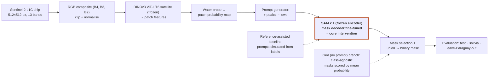

**Workshop on Artificial Intelligence and Machine Learning Applications**

# The Cost of the Prompt: Automatic DINOv3-Derived Prompts for SAM 2.1 Water Segmentation in Sentinel-2 Imagery

**[VILLARREAL QUISPE, ELIEZER GUIDO]¹, [CHAVEZ JAVIER, ROBERTO ABEL]¹**

¹[Department / group – confirm], Pontificia Universidad Católica del Perú, Lima, Peru
Corresponding author: [corresponding author e-mail]

*Status: research design for a project that has just started. No experiments have been run and no results are reported.*

---

## 1. INTRODUCTION

Mapping surface water from satellites supports water monitoring (Pekel et al., 2016) and flood assessment, including the growing share of the population exposed to floods (Tellman et al., 2021). Sentinel-2 provides optical imagery for this purpose (Drusch et al., 2012), and Sen1Floods11 offers hand-labeled 512×512-pixel chips at 10 m resolution paired with Sentinel-1 and Sentinel-2 data (Bonafilia et al., 2020). Promptable models such as SAM (Kirillov et al., 2023) and SAM 2 (Ravi et al., 2025) return a mask conditioned on a prompt; SAM 2 accepts positive or negative clicks, boxes and masks, so a person normally supplies the prompt. In remote sensing, zero-shot SAM performed poorly on permafrost landforms; ground-truth box prompts worked well but cannot be automated, whereas fine-tuning the mask decoder improved accuracy (Li et al., 2024). SAM's automatic mask generator combined with a CLIP variant has been applied to water bodies in Landsat 8 and aerial images, with failures reported for low water levels and shadows (Ozdemir et al., 2024). Prompt generation from self-supervised feature matching already exists for natural-image benchmarks (Liu et al., 2024; Zhang et al., 2024).

Transfer to Sentinel-2 is difficult: SAM 2 is trained on general-domain images and video (Ravi et al., 2025), whereas the satellite DINOv3 checkpoint we plan to use was pretrained on 0.6 m RGB imagery (official model card), more than an order of magnitude finer than the 10 m chips.

**Research question.** How much water-segmentation quality, measured as water IoU, is lost when the simulated human prompts that define a reference-assisted baseline for SAM 2.1 are replaced by prompts generated automatically from DINOv3 features, and how does that loss change on a geographic event never used for training or calibration?

**Scope.** We do not claim a new prompting method; the contribution is a controlled measurement of the cost of the prompt for Sentinel-2 water under event-level shift. Sen1Floods11 labels mark surface water, including permanent water, so the task is surface-water segmentation, not flood-only detection.

---

## 2. METHODOLOGY

**Data and splits (fact).** We use the 446 hand-labeled chips (Sentinel-2 L1C, 13 bands, top-of-atmosphere reflectance ×10,000; labels 1 = water, 0 = not water, −1 = invalid). The official files assign 252/89/90 chips to train/validation/test from ten events and keep 15 Bolivia chips apart; Paraguay contributes 39/14/14 chips to the three splits (counts read from the official split files).

**Decision.** Thresholds and hyperparameters are chosen on validation chips only; test and Bolivia are evaluated once at the end. Because chip-level splits may place neighboring chips of one event in both train and test, in-distribution scores are treated as optimistic; event-level evidence comes from Bolivia and from a leave-Paraguay-out run that excludes all 67 Paraguay chips from training, calibration and model selection.

**Preprocessing (decision).** RGB = B4, B3, B2 reflectance divided by 10,000, clipped at a fixed upper value chosen once on training chips, rescaled to [0, 1], then normalized with each model's own statistics (satellite statistics for DINOv3 from its model card; ImageNet statistics for SAM 2.1, as in its official code) and resized to the model input (1024 px for SAM 2.1). Invalid pixels are excluded from losses and metrics.

**Baseline (decision).** Frozen SAM 2.1 (Apache-2.0 checkpoints; tiny variant, 38.9 M parameters, as first choice) prompted with points sampled from each chip's ground-truth mask (positive inside water, negative outside). Because labels create these prompts, this is a reference-assisted upper reference, not a deployable system.

**Automatic prompts (decision).** A frozen DINOv3 ViT-L/16 satellite model (gated weights) extracts patch features. A logistic-regression probe predicts per-patch water probability; targets come from training-split labels only (water if ≥50% of valid pixels are water, not water if ≤5%, other patches ignored; thresholds tuned on validation). A label-free variant replaces them with NDWI (green/NIR) pseudo-labels. Probability peaks above a threshold become positive points (at most k+ per connected component, minimum spacing d) and low-probability locations become k− negative points. SAM 2.1 is called once per component with multimask output, the mask with the highest predicted IoU is kept, and the union over components is the binary prediction.

**Automatic mask grid, no prompt (decision).** Grid prompting (SAM 2's automatic mask generator, 32×32 points per side by default) yields class-agnostic masks, so it cannot output "water" by itself. We keep masks passing the predicted-IoU and stability filters, accept a mask as water if its mean DINOv3 probability exceeds a validation-tuned threshold, and take the union.

**Core intervention.** Beyond changing inputs, we unfreeze only the SAM 2.1 mask decoder (image and prompt encoders frozen) and fine-tune it on training chips with automatic prompts, using binary cross-entropy plus Dice loss.

**Ablations.** Each has a hypothesis stated beforehand, one change, and all else fixed (chips, seed, checkpoint, thresholds).

- **A1 prompt source** (ground-truth-simulated, DINOv3 points, whole-chip box, grid + scoring). *H1: DINOv3 points fall below the reference-assisted baseline and above the grid, because they carry spatial information but inherit probe errors.*
- **A2 number of points k** per component. *H2: IoU rises then saturates; extra negatives reduce false positives on wet vegetation and shadows.*
- **A3 mask decoder frozen vs fine-tuned.** *H3: fine-tuning helps events seen in training more than Bolivia.*

---

## 3. PLANNED EVALUATION

Two shifts are kept separate: natural→satellite shift is the gap between frozen and decoder-fine-tuned models on test chips; geographic shift is the gap between test chips (events seen in training) and Bolivia or leave-Paraguay-out chips.

**Metrics.** Primary: water IoU, pooled over valid pixels per set and averaged over events, plus per-chip median and interquartile range. Complementary: precision, recall and Dice/F1 for water (to separate over- from under-segmentation) and two-class mIoU for comparison with the literature. Chips without water have undefined IoU: they are excluded from per-chip IoU, kept in pooled scores and summarized by false-positive area.

**Teardown (Phase A).** Parameters and FLOPs per block (image encoder, prompt encoder, mask decoder, DINOv3) with PyTorch's FLOP counter at fixed input size; median latency over repeated runs after warm-up (batch size 1, synchronized GPU, fixed precision and hardware reported); peak GPU memory; intermediate-feature and receptive-field visualizations.

**Risks.** Gated weights (early access requests), cloud and shadow contamination (L1C has no quality mask; failure analysis by category), permanent water in the labels, the resolution gap, and a 15-chip Bolivia set (per-chip reporting, no significance claims with one seed). A single consumer-grade GPU is expected to suffice; this is an assumption to verify.

---

## 4. CONCLUSIONS

Expected contributions, without promising gains: (i) a reproducible protocol with an assisted upper reference and fully automatic variants; (ii) a teardown of SAM 2.1 and DINOv3 on Sentinel-2 RGB; (iii) an honest failure analysis under event-level shift.

Limitations: no results yet; surface water rather than flood-only water; an RGB composite discards NIR/SWIR; small held-out sets; one seed.

**For discussion:** is a label-free prompt generator (NDWI) enough, and which water surfaces break prompting?

---

## REFERENCES

Bonafilia, D., Tellman, B., Anderson, T., & Issenberg, E. (2020). Sen1Floods11: A georeferenced dataset to train and test deep learning flood algorithms for Sentinel-1. In *2020 IEEE/CVF Conference on Computer Vision and Pattern Recognition Workshops (CVPRW)* (pp. 835–845). IEEE. https://doi.org/10.1109/CVPRW50498.2020.00113

Drusch, M., Del Bello, U., Carlier, S., Colin, O., Fernandez, V., Gascon, F., Hoersch, B., Isola, C., Laberinti, P., Martimort, P., Meygret, A., Spoto, F., Sy, O., Marchese, F., & Bargellini, P. (2012). Sentinel-2: ESA's optical high-resolution mission for GMES operational services. *Remote Sensing of Environment, 120*, 25–36. https://doi.org/10.1016/j.rse.2011.11.026

Kirillov, A., Mintun, E., Ravi, N., Mao, H., Rolland, C., Gustafson, L., Xiao, T., Whitehead, S., Berg, A. C., Lo, W.-Y., Dollár, P., & Girshick, R. (2023). Segment anything. In *2023 IEEE/CVF International Conference on Computer Vision (ICCV)* (pp. 3992–4003). IEEE. https://doi.org/10.1109/ICCV51070.2023.00371

Li, W., Hsu, C.-Y., Wang, S., Yang, Y., Lee, H., Liljedahl, A., Witharana, C., Yang, Y., Rogers, B. M., Arundel, S. T., Jones, M. B., McHenry, K., & Solis, P. (2024). Segment anything model can not segment anything: Assessing AI foundation model's generalizability in permafrost mapping. *Remote Sensing, 16*(5), Article 797. https://doi.org/10.3390/rs16050797

Liu, Y., Zhu, M., Li, H., Chen, H., Wang, X., & Shen, C. (2024). Matcher: Segment anything with one shot using all-purpose feature matching. In *International Conference on Learning Representations (ICLR 2024)*. https://proceedings.iclr.cc/paper_files/paper/2024/hash/4df9a5e6bad9e64ebcea453e031142bb-Abstract-Conference.html

Ozdemir, S., Akbulut, Z., Karsli, F., & Kavzoglu, T. (2024). Extraction of water bodies from high-resolution aerial and satellite images using visual foundation models. *Sustainability, 16*(7), Article 2995. https://doi.org/10.3390/su16072995

Pekel, J.-F., Cottam, A., Gorelick, N., & Belward, A. S. (2016). High-resolution mapping of global surface water and its long-term changes. *Nature, 540*(7633), 418–422. https://doi.org/10.1038/nature20584

Ravi, N., Gabeur, V., Hu, Y.-T., Hu, R., Ryali, C., Ma, T., Khedr, H., Rädle, R., Rolland, C., Gustafson, L., Mintun, E., Pan, J., Alwala, K. V., Carion, N., Wu, C.-Y., Girshick, R., Dollár, P., & Feichtenhofer, C. (2025). SAM 2: Segment anything in images and videos. In *International Conference on Learning Representations (ICLR 2025)*. https://proceedings.iclr.cc/paper_files/paper/2025/hash/45c1f6a8cbf2da59ebf2c802b4f742cd-Abstract-Conference.html

Tellman, B., Sullivan, J. A., Kuhn, C., Kettner, A. J., Doyle, C. S., Brakenridge, G. R., Erickson, T. A., & Slayback, D. A. (2021). Satellite imaging reveals increased proportion of population exposed to floods. *Nature, 596*(7870), 80–86. https://doi.org/10.1038/s41586-021-03695-w

Zhang, R., Jiang, Z., Guo, Z., Yan, S., Pan, J., Dong, H., Qiao, Y., Gao, P., & Li, H. (2024). Personalize segment anything model with one shot. In *International Conference on Learning Representations (ICLR 2024)*. https://proceedings.iclr.cc/paper_files/paper/2024/hash/4f44e5c82dc7b0ba4472083e5dedb08e-Abstract-Conference.html

---

WAIMLAp 2026 | November 18–20, 2026 | Lima, Peru | waimlap.org
